# 资料分析 · 增长率计算与比较 · 2010 年代真题

> 所属考点：[ZL-RATE](../ZL-RATE-增长率计算与比较.md)　｜　本片 93 题

> 本片子考点：增长率计算 38　增长率比较 32　增长率计算（综合） 18　降幅与增速 5

### 2019 湖北·统一卷　第 118 题　（增长率计算）

2017 年马拉松赛事参与人次的同比增速比2016 年:

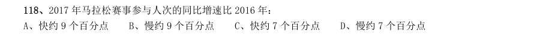

- **A.** 快约9 个百分点
- **B.** 慢约9 个百分点
- **C.** 快约7 个百分点
- **D.** 慢约7 个百分点

**答案：B**

### 2019 湖北·统一卷　第 123 题　（增长率计算）

按照2017 年的同比增速,2018 年知识产权使用费出口额约为:

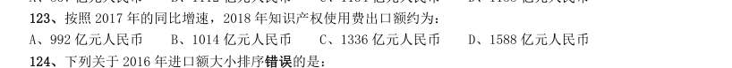

- **A.** 992 亿元人民币
- **B.** 1014 亿元人民币
- **C.** 1336 亿元人民币
- **D.** 1588 亿元人民币

**答案：C**

### 2019 湖北·选调　第 123 题　（增长率计算）

2014—2018 年,我国软件和信息技术服务业完成业务收入同比增速最接近的是:

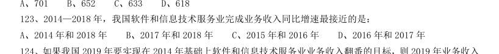

- **A.** 2014 年和2018 年
- **B.** 2017 年和2018 年
- **C.** 2015 年和2016 年
- **D.** 2016 年和2017 年

**答案：B**

### 2019 湖北·选调　第 124 题　（增长率计算）

如果我国2019 年要实现在2014 年基础上软件和信息技术服务业业务收入翻番的目标,则2019 年业务收入 同比增速要达到约:

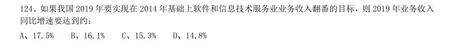

- **A.** 17.5%
- **B.** 16.1%
- **C.** 15.3%
- **D.** 14.8%

**答案：A**

### 2019 广东·县级　第 87 题　（增长率比较）

2018 年,A 省新登记市场主体中,数量较上年增幅最大的是( )。

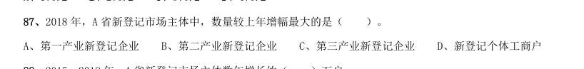

- **A.** 第一产业新登记企业
- **B.** 第二产业新登记企业
- **C.** 第三产业新登记企业
- **D.** 新登记个体工商户

**答案：暂缺**

### 2019 广东·县级　第 99 题　（增长率比较）

2017 年,下列可再生能源发电量同比增幅最大的是( )。

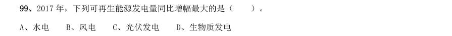

- **A.** 水电
- **B.** 风电
- **C.** 光伏发电
- **D.** 生物质发电

**答案：暂缺**

### 2019 广东·选调　第 69 题　（增长率比较）

2014—2017 年,我国电气化里程同比增速最快的是( )。

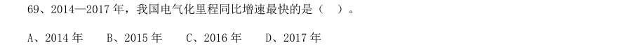

- **A.** 2014 年
- **B.** 2015 年
- **C.** 2016 年
- **D.** 2017 年

**答案：A**

### 2019 广东·选调　第 71 题　（增长率计算）
> 材料：对全国规模以上文化及相关产业5.9 万家企业的调查显示,2018 年上半年,上述企业实现营业收入42227 亿元,比上年同期增长 ,继续保持较快增长。 文化及相关产业9 个行业的营业收入均实现增长。其中,新闻信息服务营业收入3744 亿元,比上年同期增 长 ;创意设计服务5143 亿元,增长 ;内容创作生产8820 亿元,增长 ;文化传播渠道4501 亿 元,增长 ;文化辅助生产和中介服务7783 亿元,增长 ;文化消费终端生产7911 亿元,增长 ; 文化投资运营349 亿…

从增长速度看,西部地区比上年同期增长 ;东部地区增长 ;中 部地区增长 ;东北地区增长 ,与上年同期下降 相比,实现了正增长。 2016 年上半年,东北地区规模以上文化及相关产业企业实现营业收入约( )亿元。

- **A.** 425.9
- **B.** 435.9
- **C.** 437.7
- **D.** 447.7

**答案：D**

### 2019 广东·选调　第 73 题　（增长率比较）

与上年同期相比,2018 年上半年我国规模以上文化及相关产业企业营业收入增速最快的是( )。

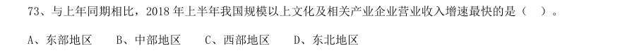

- **A.** 东部地区
- **B.** 中部地区
- **C.** 西部地区
- **D.** 东北地区

**答案：C**

### 2019 广东·选调　第 79 题　（增长率计算（综合））

2012—2015 年,社区服务中心数量同比增加最多的年份是( )。

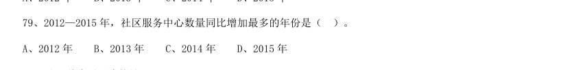

- **A.** 2012 年
- **B.** 2013 年
- **C.** 2014 年
- **D.** 2015 年

**答案：C**

### 2019 国考·地市级　第 112 题　（增长率比较）

2017 年下半年,全国进口药品数量同比增速低于上月水平的月份有几个?

- **A.** 2
- **B.** 3
- **C.** 4
- **D.** 5

**答案：C**

### 2019 国考·地市级　第 113 题　（增长率计算）

2016 年5 月,全国进口药品金额环比增速:

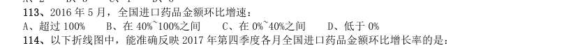

- **A.** 超过100%
- **B.** 在40%~100%之间
- **C.** 在0%~40%之间
- **D.** 低于0%

**答案：C**

### 2019 国考·地市级　第 114 题　（增长率计算）

以下折线图中,能准确反映2017 年第四季度各月全国进口药品金额环比增长率的是:

> （本题为图形题，选项为图片，见原卷）

**答案：D**

### 2019 国考·地市级　第 124 题　（增长率计算）

下列折线图中,能准确反映2018 年第一季度CN 域名钓鱼网站处理数量同比增速变化趋势的是:

> （本题为图形题，选项为图片，见原卷）

**答案：B**

### 2019 国考·省级　第 117 题　（增长率计算）

2016 年5 月,全国进口药品金额环比增速:

- **A.** 超过100%
- **B.** 在40%~100%之间
- **C.** 在0%~40%之间
- **D.** 低于0%

**答案：C**

### 2018 湖北·统一卷　第 113 题　（增长率计算）

2017 年第一季度,该省生猪出栏增速比上年同期:

- **A.** 加快12.9%
- **B.** 加快6.7%
- **C.** 加快6.5%
- **D.** 加快0.1%

**答案：C**

### 2018 湖北·统一卷　第 118 题　（增长率比较）

2013~2016 年期间,我国移动宽带用户数同比增长最快的年份是:

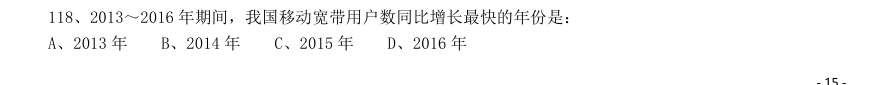

- **A.** 2013 年
- **B.** 2014 年
- **C.** 2015 年
- **D.** 2016 年

**答案：A**

### 2018 湖北·统一卷　第 122 题　（增长率比较）

在2017 年5 月我国银行业金融机构资产负债表中,下列哪一项的总资产同比增长额最高?

- **A.** 大型商业银行
- **B.** 股份制商业银行
- **C.** 城市商业银行
- **D.** 农村金融机构

**答案：A**

### 2018 国考·副省级　第 131 题　（降幅与增速）
> 材料：2017 年1~2 月,全国造船完工936 万载重吨,同比增长123%;承接新船订单221 万载重吨,同比增长133%。 2 月末,手持船舶订单9207 万载重吨,同比下降22.6%,比2016 年末下降7.6%。 2017 年1~2 月,全国完工出口船907 万载重吨,同比增长127%;承接出口船订单191 万载重吨,同比增长 122%。2 月末,手持出口船订单8406 万载重吨,同比下降25.9%。 2017 年1~2 月,53 家重点监测的造船企业(以下简称重点企业)造…

2017 年1~2 月,重点企业完工出口船886 万载重吨,同比增长138%;承接出口船订单171 万载重吨,同比 增长109%。2 月末,手持出口船订单8129 万载重吨,同比下降26.6%。 2016 年末全国手持船舶订单较同年2 月末:

- **A.** 降低16.2%
- **B.** 降低2.2%
- **C.** 增加16.2%
- **D.** 增加2.2%

**答案：A**

### 2018 国考·副省级　第 133 题　（增长率比较）

2017 年1~2 月,重点企业下列指标中同比增速最快的是:

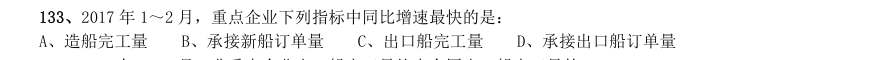

- **A.** 造船完工量
- **B.** 承接新船订单量
- **C.** 出口船完工量
- **D.** 承接出口船订单量

**答案：C**

### 2018 国考·地市级　第 128 题　（增长率比较）

2017 年1~2 月,重点企业下列指标中同比增速最快的是:

- **A.** 造船完工量
- **B.** 承接新船订单量
- **C.** 出口船完工量
- **D.** 承接出口船订单量

**答案：C**

### 2017 湖北·统一卷　第 107 题　（增长率计算）

按2016 年1-6 月份的同比增速,2017 年1-6 月份城镇消费品零售额约为:

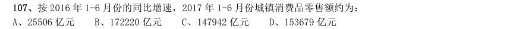

- **A.** 25506 亿元
- **B.** 172220 亿元
- **C.** 147942 亿元
- **D.** 153679 亿元

**答案：C**

### 2017 湖北·统一卷　第 108 题　（增长率比较）

2016 年1~6 月份,以下选项中,商品零售同比增速最快的是:

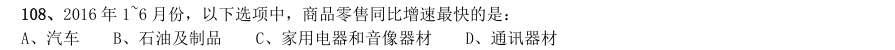

- **A.** 汽车
- **B.** 石油及制品
- **C.** 家用电器和音像器材
- **D.** 通讯器材

**答案：D**

### 2017 湖北·统一卷　第 109 题　（增长率计算（综合））

2016 年6 月份,城镇消费品零售额比上年同期增加:

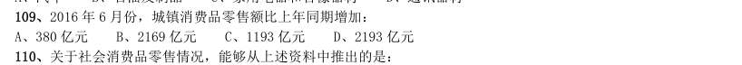

- **A.** 380 亿元
- **B.** 2169 亿元
- **C.** 1193 亿元
- **D.** 2193 亿元

**答案：D**

### 2017 湖北·统一卷　第 123 题　（增长率计算）

2015 年全年接收社会捐赠款的同比增长率较2014 年:

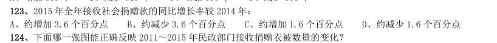

- **A.** 约增加3.6 个百分点
- **B.** 约减少3.6 个百分点
- **C.** 约增加1.6 个百分点
- **D.** 约减少1.6 个百分点

**答案：C**

### 2017 广东·统一卷　第 87 题　（降幅与增速）

2016 年,小微服务业经营平稳面同比扩大最显著的是:

- **A.** 1 季度
- **B.** 2 季度
- **C.** 3 季度
- **D.** 4 季度

**答案：暂缺**

### 2017 国考·副省级　第 116 题　（增长率比较）
> 材料：理。 (一) 某市2015 年全年粮食总产量4.16 万吨,同比下降2.3%;甘蔗产量0.57 万吨,下降23.6%;油料产量0.12 万吨,增长32.4%;蔬菜产量15.79 万吨,下降3.4%;水果产量7.84 万吨,增长7.4%。 全年水产品产量29.16 万吨,同比增长3.6%,其中海洋捕捞1.09 万吨,与上年持平;海水养殖6.07 万吨, 增长89.5%;淡水捕捞0.18 万吨,增长1.1%;淡水养殖21.81 万吨,下降7.9%。…

2010-2015 年某市粮食产量及其增速 2014 年该市蔬菜产量比水果产量约高多少万吨?

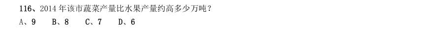

- **A.** 9
- **B.** 8
- **C.** 7
- **D.** 6

**答案：A**

### 2017 国考·副省级　第 121 题　（增长率比较）
> 材料：截至2014 年末,我国共有博物馆3658 个,占文物机构总数的43.5%。全国文化机构拥有文物藏品4063.58 万件,比上年末增加222.77 万件。其中,博物馆文物藏品2929.97 万件,文物商店文物藏品770.00 万件。文物 藏品中,一级文物9.82 万件,二级文物68.82 万件,三级文物340.51 万件。…

2014 年全国文物机构共安排基本陈列9996 个,比上年增长19.1%;举办临时展览11174 个,增长15.8%; 接待观众84256 万人次,增长12.8%,其中博物馆接待观众71774 万人次,占文物机构接待观众总人次的85.2%。 2014 年,我国文物机构相关指标同比增速最快的是:

- **A.** 从业人员数
- **B.** 参观人数
- **C.** 文物机构数
- **D.** 未成年人参观人数

**答案：B**

### 2017 国考·副省级　第 131 题　（增长率比较）

中国新能源汽车产业各类技术专利申请情况表 单位:件 年份 整车制造 电动机制造 储能装置制 造 零部件 配件制造 传能装置制 造 表中新能源汽车产业零部件配件制造技术专利申请数增速最快的年份为:

- **A.** 2005 年
- **B.** 2002 年
- **C.** 2014 年
- **D.** 2010 年

**答案：A**

### 2017 国考·地市级　第 126 题　（增长率比较）

单位:件 表中新能源汽车产业零部件配件制造技术专利申请数增速最快的年份为:

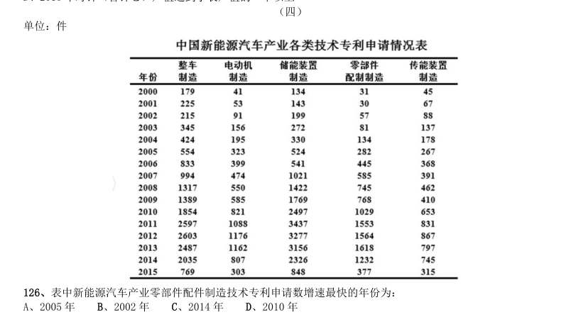

- **A.** 2005 年
- **B.** 2002 年
- **C.** 2014 年
- **D.** 2010 年

**答案：A**

### 2016 湖北·统一卷　第 109 题　（增长率计算（综合））

2015 年3 月末,中央企业的资产负债率(负债总额÷资产总额)约在以下哪个范围内?

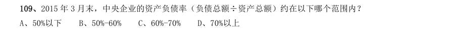

- **A.** 50%以下
- **B.** 50%-60%
- **C.** 60%-70%
- **D.** 70%以上

**答案：C**

### 2016 湖北·统一卷　第 122 题　（增长率比较）

下列月份中,全国租赁贸易进出口总额环比增速最快的是:

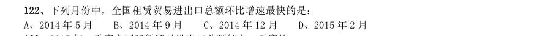

- **A.** 2014 年5 月
- **B.** 2014 年9 月
- **C.** 2014 年12 月
- **D.** 2015 年2 月

**答案：C**

### 2016 湖北·统一卷　第 123 题　（增长率计算）

2015 年一季度全国租赁贸易进出口总额较上一季度约:

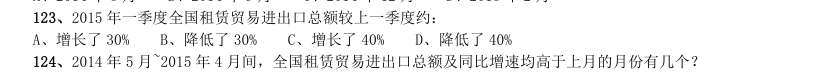

- **A.** 增长了30%
- **B.** 降低了30%
- **C.** 增长了40%
- **D.** 降低了40%

**答案：B**

### 2016 湖北·统一卷　第 124 题　（增长率比较）

2014 年5 月~2015 年4 月间,全国租赁贸易进出口总额及同比增速均高于上月的月份有几个?

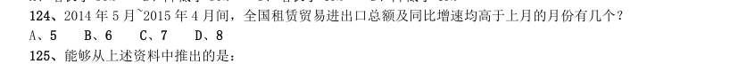

- **A.** 5
- **B.** 6
- **C.** 7
- **D.** 8

**答案：B**

### 2016 广东·乡镇　第 86 题　（增长率计算（综合））
> 材料：请你根据资料所提供的信息进行分析、比较、计算和判断处理。 (一) 根据下列资料,回答86~90 题: 从2014 年起,我省在粤东西北地区以县(市、区)为单位遴选首批14 个省级新农村连片示范建 设工程,三年将建成42 个省级新农村示范片(不含珠三角地区)。根据工作进度安排,示范片建设一 年初见成效,两年基本实现目标。与此同时,珠三角地区每年选取6 个片区开展示范片建设,为期三 年。 截至2015 年年底,全省第一、二批40 个示范片(含珠三角6 市)启动建设项目2693 个…

第二批391 个自然村 中,有67.0%的自然村实现通自来水。 村巷道硬底化建设:首批示范片中完成村巷道硬底化建设的自然村有256 个,占68.3%。第二批中 有59.8%的自然村完成村巷道硬底化建设。 群众参与共谋共建情况:首批示范片375 个自然村中,成立村民理事会的占99.7%。第二批391 个 自然村中,成立村民理事会的占98.2%。 在第一、二批40 个示范片(含珠三角6 市)已竣工的项目中,粤东西北地区约占了( )。

- **A.** 47%
- **B.** 48%
- **C.** 49%
- **D.** 50%

**答案：暂缺**

### 2016 广东·乡镇　第 93 题　（增长率计算）

2011—2014 年,新型农村合作医疗受益人次增长率最高的是( )年。

- **A.** 2011
- **B.** 2012
- **C.** 2013
- **D.** 2014

**答案：暂缺**

### 2016 广东·乡镇　第 97 题　（增长率计算）

按2011 年的人口自然增长率计算,预计2012 年的人口约为( )万人。

- **A.** 135382
- **B.** 135409
- **C.** 141129
- **D.** 141202

**答案：暂缺**

### 2016 国考·副省级　第 128 题　（增长率比较）

2014 年,以下哪个现代服务业新登记注册企业的户数同比增速最快?

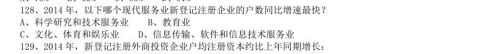

- **A.** 科学研究和技术服务业
- **B.** 教育业
- **C.** 文化、体育和娱乐业
- **D.** 信息传输、软件和信息技术服务业

**答案：D**

### 2016 国考·副省级　第 129 题　（增长率计算）

2014 年,新登记注册外商投资企业户均注册资本约比上年同期增长:

- **A.** 17%
- **B.** 12%
- **C.** 8%
- **D.** 4%

**答案：A**

### 2015 湖北·统一卷　第 109 题　（增长率比较）

2013 年上半年与上年同期相比,下面四个税种中增速最快的税种是:

- **A.** 企业所得税
- **B.** 国内增值税
- **C.** 出口货物增值税消费税
- **D.** 契税

**答案：D**

### 2015 湖北·统一卷　第 110 题　（增长率比较）

下列说法与资料相符合的有几个: 12013 年第一季度我国税收总收入同比增速低于7.9% 22013 年我国税收总收入预计可以达到118520 亿元 3若2013 年上半年进口货物增值税消费税维持上年同期水平,那么,2013 年上半年我国税收总收入同比增长将 比2012 年提高约0.5 个百分点 42013 年我国上半年企业所得税、国内增值税两项之和超过同期税收总收入的50%

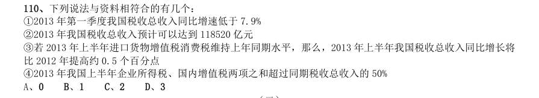

- **A.** 0
- **B.** 1
- **C.** 2
- **D.** 3

**答案：C**

### 2015 广东·乡镇　第 87 题　（增长率计算（综合））

2014 年,移动电话用户数比2008 年增长约:

- **A.** 58%
- **B.** 68%
- **C.** 78%
- **D.** 88%

**答案：暂缺**

### 2015 广东·乡镇　第 94 题　（降幅与增速）

2014 年商用车市场销量降幅较大,原因在于:

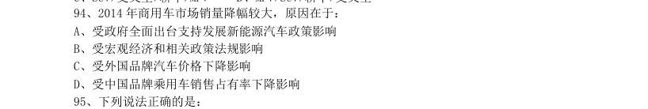

- **A.** 受政府全面出台支持发展新能源汽车政策影响
- **B.** 受宏观经济和相关政策法规影响
- **C.** 受外国品牌汽车价格下降影响
- **D.** 受中国品牌乘用车销售占有率下降影响

**答案：暂缺**

### 2015 广东·乡镇　第 97 题　（增长率计算）

2013 年 月,我国对各大洲出口苹果数量同比增长率的大小关系是:

- **A.** 大洋洲<亚洲
- **B.** 南美洲>北美洲
- **C.** 亚洲>南美洲
- **D.** 北美洲<大洋洲

**答案：暂缺**

### 2015 广东·县级　第 86 题　（增长率计算）

问题,请你根据资料所提供的信息进行分析、比较、计算和判断处理。 (一) 2014 年 月,我国手机出货量与上月相比增长率最高的月份是:

- **A.** 2 月
- **B.** 3 月
- **C.** 6 月
- **D.** 11 月

**答案：暂缺**

### 2015 广东·县级　第 94 题　（降幅与增速）

2014 年商用车市场销量降幅较大,原因在于:

- **A.** 受政府全面出台支持发展新能源汽车政策影响
- **B.** 受宏观经济和相关政策法规影响
- **C.** 受外国品牌汽车价格下降影响
- **D.** 受中国品牌乘用车销售占有率下降影响

**答案：暂缺**

### 2015 广东·县级　第 98 题　（增长率计算）

与2013 年相比,珠江水系2014 年货运周转量增长率最高、最低的分别是:

- **A.** 一季度、二季度
- **B.** 一季度、三季度
- **C.** 四季度、三季度
- **D.** 四季度、二季度

**答案：暂缺**

### 2015 广东·县级　第 99 题　（增长率计算）

与2013 年相比,珠江水系2014 年客货运输量增长率最低的是:

- **A.** 货运量
- **B.** 货运周转量
- **C.** 客运量
- **D.** 客运周转量

**答案：暂缺**

### 2015 国考·副省级　第 122 题　（增长率计算）

2013 年全国工业企业的税金增速比利润增速:

- **A.** 低1.2 个百分点
- **B.** 低5.8 个百分点
- **C.** 高7.0 个百分点
- **D.** 高8.4 个百分点

**答案：A**

### 2015 国考·地市级　第 117 题　（增长率计算）

2013 年全国工业企业的税金增速比利润增速:

- **A.** 低1.2 个百分点
- **B.** 低5.8 个百分点
- **C.** 高7.0 个百分点
- **D.** 高8.4 个百分点

**答案：A**

### 2014 湖北·统一卷　第 109 题　（增长率计算）

2013 年3 月末,房地产开发余额同比增速为:

- **A.** 14.4%
- **B.** 12.3%
- **C.** 19.3%
- **D.** 21.4%

**答案：A**

### 2014 湖北·统一卷　第 111 题　（增长率比较）

图 2008—2012 年全国一次能源、石油生产量与消费量的情况 图2 2008—2012 年全国矿产品进出口情况 2009—2012 年间一次能源生产量增速最快的一年是:

- **A.** 2009 年
- **B.** 2010 年
- **C.** 2011 年
- **D.** 2012 年

**答案：B**

### 2014 湖北·统一卷　第 116 题　（增长率计算）
> 材料：2012 年,某省规模以上工业增加值10875 亿元,比上年增长7.1%,月度增速从1-2 月的2.9%回升到10-12 月的 10%以上,大型、中型和小微型企业增加值分别为3074、3217 和4584 亿元,比上年分别增长8.2%、6.8%和6.7%。 2012 年,该省规模以上工业企业主营收入56730 亿元,比上年增长3.5%,增速比全国低7.5 个百分点;利润总 额2900 亿元,比上年下降6.1%。…

2012 某省规模以上工业增加值同比增速情况: 与2011 年相比,2012 年该省规模以上工业增加值约增加了多少亿元?

- **A.** 600
- **B.** 720
- **C.** 840
- **D.** 960

**答案：B**

### 2014 湖北·统一卷　第 117 题　（增长率比较）

2012 年3—10 月间,中型企业增加值增速和规模以上工业增加值总体增速差异最大的月份是:

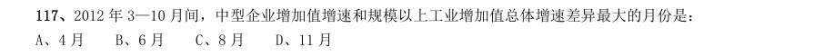

- **A.** 4 月
- **B.** 6 月
- **C.** 8 月
- **D.** 11 月

**答案：A**

### 2014 湖北·统一卷　第 118 题　（增长率计算）

2012 年3—10 月间,三类企业工业增加值同比增速均超过5%的月份有几个?

- **A.** 5
- **B.** 6
- **C.** 7
- **D.** 8

**答案：A**

### 2014 湖北·统一卷　第 119 题　（增长率比较）

与2011 年相比,2012 年全国规模以上工业企业主营业务收入:

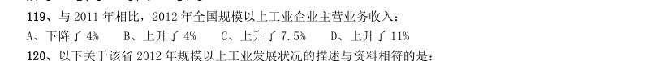

- **A.** 下降了4%
- **B.** 上升了4%
- **C.** 上升了7.5%
- **D.** 上升了11%

**答案：D**

### 2014 广东·乡镇　第 94 题　（增长率计算）

2013 年,我省各类运输业中,货运量和货物周转量增长率均超过15%的是:

- **A.** 公路、水路
- **B.** 公路、航空
- **C.** 水路、航空
- **D.** 铁路、管道

**答案：暂缺**

### 2014 广东·县级　第 88 题　（增长率计算（综合））

广东高速公路在2012 年实现通车里程比2011 年增长约:

- **A.** 9.4%
- **B.** 109.4%
- **C.** 270%
- **D.** 370%

**答案：暂缺**

### 2014 广东·县级　第 92 题　（增长率计算（综合））

2013 年我国中等职业教育招生人数比2012 年大约:

- **A.** 减少7.4%
- **B.** 减少8.4%
- **C.** 增加7.4%
- **D.** 增加8.4%

**答案：暂缺**

### 2014 广东·县级　第 98 题　（增长率计算（综合））

2013 年,珠三角完成投资比上年增长约:

- **A.** 6.4%
- **B.** 14.9%
- **C.** 23.2%
- **D.** 30.5%

**答案：暂缺**

### 2014 国考·统一卷　第 131 题　（增长率比较）

2008-2012 年国家电网公司机组并网容量 单位:万千瓦 2008-2012 年国家电网公司机组上网电量 单位:亿千瓦时 下列年份中,国家电网公司并网机组总上网电量同比增速最快的是:

- **A.** 2010 年
- **B.** 2009 年
- **C.** 2012 年
- **D.** 2011 年

**答案：A**

### 2013 湖北·统一卷　第 143 题　（增长率比较）

下列选项中,汽车产量同比增速最低的是:

- **A.** 2010 年4 月
- **B.** 2010 年5 月
- **C.** 2011 年4 月
- **D.** 2011 年5 月

**答案：D**

### 2013 湖北·统一卷　第 153 题　（增长率计算）

该市种业收入增长速度:

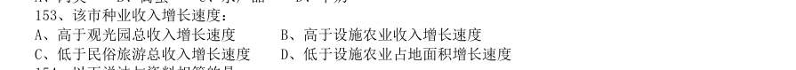

- **A.** 高于观光园总收入增长速度
- **B.** 高于设施农业收入增长速度
- **C.** 低于民俗旅游总收入增长速度
- **D.** 低于设施农业占地面积增长速度

**答案：C**

### 2013 广东·一卷　第 86 题　（增长率比较）
> 材料：请你根据资料所提供的信息进行分析、比较、计算和判断处理。 (一) 2012 年,某地区农作物播种总面积达到1625.55 万亩,同比增长4.6%。其中,粮食和蔬菜播种面积大幅增长, 分别为459.40 万亩、109.06 万亩,同比增长32.7%和30.5%;棉花、油料和甜菜播种面积下降,分别为 698.52 万亩、103.42 万亩、30.45 万亩,同比下降17.3%、5.7%和18.2%。粮食作物中,小麦295.61 万亩, 同比增长67.7%;玉米93.77 万亩,同…

蔬菜播种面积中,番茄65.48 万亩,同比增长60.7%;辣椒21.27 万亩,同比下降0.7%。 (注:与上一年同一时期相比称为“同比”。) 2012 年,下列农作物播种面积同比增幅最大的一种是:

- **A.** 棉花
- **B.** 小麦
- **C.** 玉米
- **D.** 番茄

**答案：暂缺**

### 2013 国考·统一卷　第 119 题　（增长率计算（综合））

若该省高新技术产业增加值保持同样的增长速度,则2012 年前十一个月高新技术产业增加值比2010 年同 期约增加多少亿元:

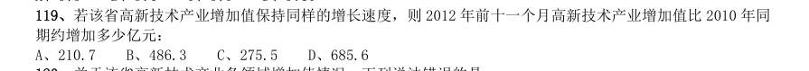

- **A.** 210.7
- **B.** 486.3
- **C.** 275.5
- **D.** 685.6

**答案：B**

### 2013 国考·统一卷　第 129 题　（降幅与增速）

已经公布一季报的钢铁板块公司2010 年第四季度的净利率(净利润比营业收入)约为:

- **A.** 2.57%
- **B.** 1.80%
- **C.** -0.96%
- **D.** -0.61%

**答案：D**

### 2013 国考·统一卷　第 131 题　（增长率计算）
> 材料：2011 年全国农民工总量达到25278 万人,比上年增加1055 万人,增长4.4%。农民工从业仍以制造业、建筑 业和服务业为主,从事建筑业的比重明显提高。从农民工的就业地区来看,2011 年在东部地区务工的农民工16537 万人,比上年增加324 万人;在中部地区务工的农民工4438 万人,比上年增加334 万人,增长8.1%;在西部地 区务工的农民工4215 万人,比上年增加370 万人,增长9.6%。…

2008~2011 年农民工从事的主要行为分布 单位:% 2011 年农民工在不同地区从事的主要行业分布 单位:% 与上一年相比,2011 年在东部地区务工的农民工人数增长率约为:

- **A.** 2.0%
- **B.** 4.4%
- **C.** 5.2%
- **D.** 8.1%

**答案：A**

### 2012 湖北·统一卷　第 102 题　（增长率计算（综合））

2005—2010 年股票、基金交易量同比增长的年份共有几个:

- **A.** 1 个
- **B.** 2 个
- **C.** 3 个
- **D.** 4 个

**答案：C**

### 2012 湖北·统一卷　第 104 题　（增长率计算（综合））

2005—2010 年财产险每年赔款支出与保费收入之比大约在什么范围内:

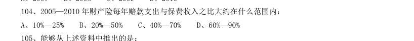

- **A.** 10%—25%
- **B.** 20%—50%
- **C.** 40%—70%
- **D.** 60%—90%

**答案：C**

### 2012 湖北·统一卷　第 107 题　（增长率计算）

下列2011 年1—11 月该省旅游统计数据中,同比增长速度大于全年的是:

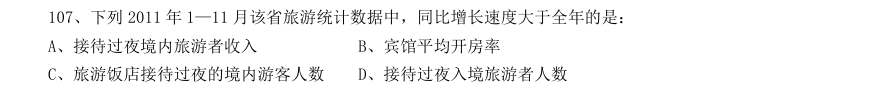

- **A.** 接待过夜境内旅游者收入
- **B.** 宾馆平均开房率
- **C.** 旅游饭店接待过夜的境内游客人数
- **D.** 接待过夜入境旅游者人数

**答案：B**

### 2012 湖北·统一卷　第 111 题　（增长率计算（综合））

2011 年对主要国家和地区进出口额及其增长速度 2010 年我国全年货物进出口差额为多少亿美元:

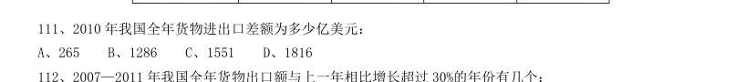

- **A.** 265
- **B.** 1286
- **C.** 1551
- **D.** 1816

**答案：D**

### 2012 湖北·统一卷　第 118 题　（增长率比较）

2010—2011 年,下列哪项年增长速度最快:

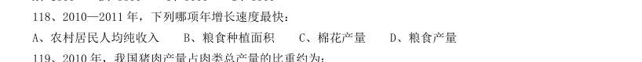

- **A.** 农村居民人均纯收入
- **B.** 粮食种植面积
- **C.** 棉花产量
- **D.** 粮食产量

**答案：A**

### 2012 广东·统一卷　第 88 题　（增长率比较）

如果2011 年下半年各项服务性消费支出的数值 与2011 年上半年相同,则2011 年较2005 年增长率 最大的一项服务性消费支出是:

- **A.** 在外饮食服务费
- **B.** 家庭服务费
- **C.** 医疗费
- **D.** 交通费

**答案：暂缺**

### 2012 广东·统一卷　第 92 题　（增长率计算（综合））

2011 年水路旅客周转量比上年增长约:

- **A.** 13%
- **B.** 17%
- **C.** 21%
- **D.** 25%

**答案：暂缺**

### 2012 广东·统一卷　第 97 题　（增长率计算）

如果2011 年从业人员人数年增长率与2010 年相同,则2011 年从业人员人数约为多少万:

- **A.** 22.8
- **B.** 23.4
- **C.** 24.9
- **D.** 25.7

**答案：暂缺**

### 2012 国考·统一卷　第 118 题　（增长率计算）

2010 年,该省地市级广电收入的同比增速约为:

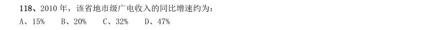

- **A.** 15%
- **B.** 20%
- **C.** 32%
- **D.** 47%

**答案：D**

### 2012 国考·统一卷　第 133 题　（增长率比较）

在2010 年我国进出口贸易中,下列哪一项的同比增长金额最高:

- **A.** 机电产品出口
- **B.** 高新技术产品出口
- **C.** 机电产品进口
- **D.** 高新技术产品进口

**答案：A**

### 2011 湖北·统一卷　第 102 题　（增长率比较）

相对于2001 年,10 年的销售份额增长率最大的车型是:

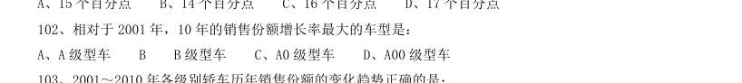

- **A.** A 级型车B
- **B.** 级型车
- **C.** A0 级型车
- **D.** A00 级型车

**答案：B**

### 2011 湖北·统一卷　第 104 题　（增长率计算（综合））

因1.6 升购置税调整,A 级型车市场从2008 年到2009 年的上升率相对于B 级型车同比下降率的比值约 为:

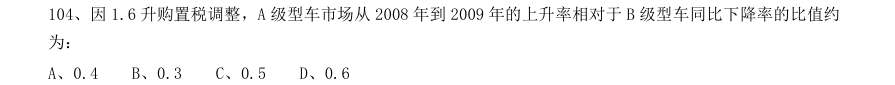

- **A.** 0.4
- **B.** 0.3
- **C.** 0.5
- **D.** 0.6

**答案：C**

### 2011 湖北·统一卷　第 107 题　（增长率计算（综合））

资料中括号处应填入的数字为:

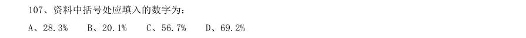

- **A.** 28.3%
- **B.** 20.1%
- **C.** 56.7%
- **D.** 69.2%

**答案：D**

### 2011 湖北·统一卷　第 108 题　（增长率计算（综合））

2010 年1~3 月,法国对中国出口的各类产品中,出口额比上年同期增长最多的是:

- **A.** 机电产品
- **B.** 运输设备
- **C.** 化工产品
- **D.** 家具玩具

**答案：B**

### 2011 湖北·统一卷　第 114 题　（增长率计算（综合））

若保持2009 年的增长速度,哪一年水果的年产量开始超过糖蔗:

- **A.** 2011 年
- **B.** 2010 年
- **C.** 2012 年
- **D.** 2013 年

**答案：A**

### 2011 湖北·统一卷　第 117 题　（增长率计算）

已知2010 年该省限额以下批发和零售企业零售额相比于2009 年同期增幅为18.7%,那么2009 年该省限 额以下批发和零售企业零售额均为:

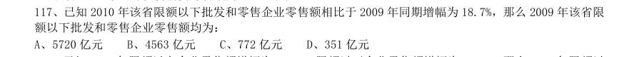

- **A.** 5720 亿元
- **B.** 4563 亿元
- **C.** 772 亿元
- **D.** 351 亿元

**答案：A**

### 2011 湖北·统一卷　第 118 题　（增长率计算）

已知2010 年限额以上企业零售额增幅为27.4%,限额以下企业零售额增幅为12.8%,那么2009 年限额以 下企业和限额以上企业零售额差值比2010 年差值:

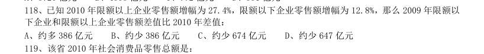

- **A.** 约多386 亿元
- **B.** 约少386 亿元
- **C.** 约少674 亿元
- **D.** 约少647 亿元

**答案：A**

### 2011 广东·统一卷　第 87 题　（增长率计算（综合））

2006 年,我国的出口额约比上年增长:

- **A.** 27.2%
- **B.** 23.8%
- **C.** 23.2%
- **D.** 19.9%

**答案：暂缺**

### 2011 广东·统一卷　第 88 题　（增长率计算）

2003—2006 年的进口额年增长率超过25%的年份有几个:

- **A.** 1
- **B.** 2
- **C.** 3
- **D.** 4

**答案：暂缺**

### 2011 广东·统一卷　第 89 题　（增长率计算）

与上年相比,进出口总额的年增长率最高的年份的进出口额为:

- **A.** 17607 亿美元
- **B.** 14220 亿美元
- **C.** 8510 亿美元
- **D.** 5208 亿美元

**答案：暂缺**

### 2010 湖北·统一卷　第 95 题　（增长率计算）

如果按 年的增长率,第一产业在2010 年可实现增加值多少亿元:

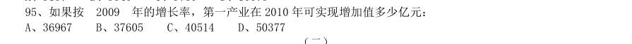

- **A.** 36967
- **B.** 37605
- **C.** 40514
- **D.** 50377

**答案：A**

### 2010 湖北·统一卷　第 97 题　（增长率比较）

“家电下乡”产品销售额增幅最大的是几月份:

- **A.** 2 月
- **B.** 3 月
- **C.** 7 月
- **D.** 12 月

**答案：A**

### 2010 湖北·统一卷　第 102 题　（增长率计算）

根据以下资料,完成各题。 2004-2009 年全国猪肉产量 单位:万吨 与 年相比,2009 年猪肉产量增长率为:

- **A.** 4.6%
- **B.** 5.8%
- **C.** 7.1%
- **D.** 10.2%

**答案：B**

### 2010 湖北·统一卷　第 103 题　（增长率计算）

2004-2009 年,增长率最高的是哪个时期:

- **A.** 2005 年
- **B.** 2004-2006 年
- **C.** 2008 年
- **D.** 2007-2009 年

**答案：C**

### 2010 广东·统一卷　第 76 题　（增长率比较）

下列时段中,农村居民最低生活保障人数年增长率变化幅度最大的是:

- **A.** 2002 年至2003 年
- **B.** 2003 年至2004 年
- **C.** 2004 年至2005 年
- **D.** 2005 年至2006 年

**答案：暂缺**

### 2010 广东·统一卷　第 81 题　（增长率比较）

与前一年相比,工业废水排放达标率增幅最大的年份是:

- **A.** 2005 年
- **B.** 2006 年
- **C.** 2007 年
- **D.** 2008 年

**答案：暂缺**
