# 资料分析 · 增长率计算与比较 · 2020 年代真题

> 所属考点：[ZL-RATE](../ZL-RATE-增长率计算与比较.md)　｜　本片 52 题

### 2025 广东·统一卷　第 72 题　（增长率计算（综合））

2023年,G省社会消费品零售额同比增长( )。

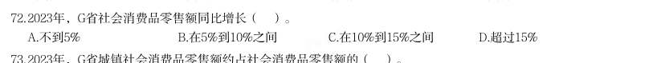

- **A.** 不到5%
- **B.** 在5%到10%之间
- **C.** 在10%到15%之间
- **D.** 超过15%

**答案：暂缺**

### 2025 广东·统一卷　第 74 题　（增长率计算）

2023年,G省下列指标的社会消费品零售额同比增长率最高的是( )。

- **A.** 城镇
- **B.** 乡村
- **C.** 商品零售
- **D.** 餐饮收入

**答案：暂缺**

### 2025 广东·统一卷　第 81 题　（增长率计算（综合））

2023年,G省博物馆数量同比增长约( )。

- **A.** 2.1%
- **B.** 4.2%
- **C.** 6.3%
- **D.** 8.4%

**答案：暂缺**

### 2025 广东·统一卷　第 84 题　（增长率计算（综合））

2017~2023年间,G省国有博物馆同比增加数量最多的是( )。

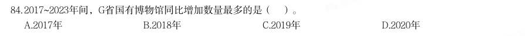

- **A.** 2017年
- **B.** 2018年
- **C.** 2019年
- **D.** 2020年

**答案：暂缺**

### 2025 广东·统一卷　第 86 题　（增长率计算（综合））

【认准淘宝店铺:通关达人资料库】公考,事业编,遴选,考研,一站式备考,持续更新 2023年,国家铁路旅客发送量同比增长约( )。

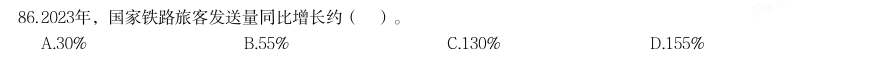

- **A.** 30%
- **B.** 55%
- **C.** 130%
- **D.** 155%

**答案：暂缺**

### 2025 国考·副省级　第 117 题　（增长率计算）

如2024年5-12月,我国集成电路布图设计登记月均发证量与1-4月水平相同,则2024年全年,我国集成电路布 图设计登记发证量将比上年:

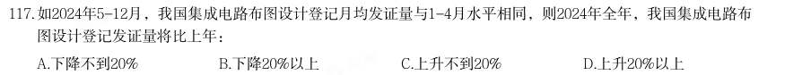

- **A.** 下降不到20%
- **B.** 下降20%以上
- **C.** 上升不到20%
- **D.** 上升20%以上

**答案：C**

### 2025 国考·副省级　第 118 题　（增长率计算）

2019-2021年,我国集成电路布图设计登记申请量三年的同比增速:

- **A.** 先升后降
- **B.** 先降后升
- **C.** 逐年上升
- **D.** 逐年下降

**答案：D**

### 2024 湖北·统一卷　第 114 题　（增长率计算（综合））

2022年,中国、巴西、俄罗斯、印度、南非五国创新指数之和同比:

- **A.** 增长约3.2%
- **B.** 增长约4.8%
- **C.** 下降约3.2%
- **D.** 下降约4.8%

**答案：C**

### 2024 湖北·统一卷　第 116 题　（增长率计算）
> 材料：(三) 2022年,全国共有260家银行机构和29家理财公司累计新发理财产品2.94万只,同比下降38.23%,降幅比上 年同期扩大7.22个百分点;累计募集资金89.62万亿元,同比减少32.57万亿元。 截至2022年底,全国共有278家银行机构和29家理财公司有存续的理财产品,共存续产品3.47万只,同比下 降4.41%;存续规模27.65万亿元,同比下降4.66%。分机构类型来看,理财公司存续产品13947只,存续规模 22.24万亿元,同比增长29.36%。银行机构…

截至2022年底,持有理财产品的投资者数量为9671.27万个,较年初增长18.96%,其中机构投资者数量为 95.95万个,数量占比同比提升了0.22个百分点;在持有理财产品的个人投资者中,数量最多的是风险偏好为二 级(稳健型)的投资者,占比35.44%。 2022年全国银行机构和理财公司累计新发理财产品只数与2020年相比约:

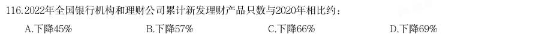

- **A.** 下降45%
- **B.** 下降57%
- **C.** 下降66%
- **D.** 下降69%

**答案：B**

### 2024 湖北·统一卷　第 121 题　（降幅与增速）

2022年我国报废机动车回收数量399.1万辆,同比增长32.9%,回收数量占我国机动车保有量的 。 相比2021年,2022年我国十个品种再生资源回收重量降幅超过10%的有:

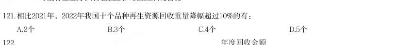

- **A.** 2个
- **B.** 3个
- **C.** 4个
- **D.** 5个

**答案：B**

### 2024 广东·统一卷　第 71 题　（增长率计算（综合））
> 材料：所给出的图、表、文字或综合性资料均有若干个问题要你回答。你应根据 资料提供的信息进行分析、比较、计算和判断处理。 (一) 党的二十大报告强调,教育、科技、人才是全面建设社会主义现代化国家的基础性、战略性支撑。近年 来,广东紧紧围绕制造业当家、聚焦高质量发展,大力实施制造业当家技能人才支撑工程,加快建设一支规模 宏大的知识型、技能型、创新型技能人才队伍。2023年,全省技能人才总量达1934万人,其中高技能人才657 万人。 为推动广东技工与广东制造共同成长,近年来,广东紧紧围…

2023年,广东共有技工院校148所,实现21个地级以上市技师学院全覆盖;在校生65万人,占全国的七分 之一;面向先进制造业、战略性新兴产业、现代服务业建设233个省级重点专业和50个特色专业;与100多家世 界500强企业及国内800多家大型企业开展深度合作,实现教学与企业岗位无缝对接,精准培养产业急需人才。 技工院校招生人数、教研成果、技能竞赛、就业率等九项主要指标均居全国第一。 2022年世界技能大赛,广东共有11位选手代表国家参赛,获7金、1银、1铜和2个优胜奖,金牌数占全国三 分之一,金牌数及奖牌数连续4届位居全国第一,展现了广东技能人才的精湛技能和职业风采。 2023年广东高技能人才是全省技能人才总量的( )。

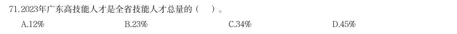

- **A.** 12%
- **B.** 23%
- **C.** 34%
- **D.** 45%

**答案：B**

### 2024 广东·统一卷　第 78 题　（增长率计算（综合））

2022年,中国国民经济的18个行业大类中有( )个行业的对外直接投资流量同比有所增加。

- **A.** 4
- **B.** 5
- **C.** 6
- **D.** 7

**答案：A**

### 2024 广东·统一卷　第 81 题　（降幅与增速）
> 材料：(三) 自2022年1月1日《中华人民共和国法律援助法》施行以来,我国法律援助覆盖面不断扩大、服务水平显著 提升。据统计,2022年全国法律援助机构共组织办理法律援助案件137万余件,值班律师提供法律帮助95万余 件,为1980万余人次提供法律咨询,提供法律咨询人次同比增加约5%。…

2022年,G省法律援助机构共组织办理法律援助案件(以下简称G省法律援助案件)195779件,较2021年减 少40937件,同比下降17.29%,其中刑事案件133509件(含值班律师法律帮助案件65647件),民事案件61754 件,行政案件516件。帮助受援群众212993人。 2022年,G省法律援助案件数量约占全国的( )。

- **A.** 9.2%
- **B.** 14.3%
- **C.** 19.4%
- **D.** 24.5%

**答案：C**

### 2024 广东·统一卷　第 84 题　（增长率计算）

下列选项最有可能准确反映了2018-2022年间G省法律援助机构办理的相关案件的同比增长率的是( )。

- **A.** 
- **B.** 
- **C.** 
- **D.** 

**答案：D**

### 2024 广东·统一卷　第 86 题　（增长率计算）
> 材料：(四) 2021年,各地区各部门全面落实党中央、国务院关于实现数字乡村发展战略的决策部署,积极引入社会资 本投资建数字乡村。…

2021年全国用于县域农业农村信息化建设的社会资本投入为954.6亿元,县均社会资本投入 3588.8万元、乡村人均社会资本投入135.2元,分别比上年增长17.2%和24.0%。分区域看,东部地区社会资本投 入562.4亿元,占全国社会资本投入58.9%;中部地区社会资本投入193.8亿元;西部地区社会资本投入198.4亿 元。 2019-2021年,全国县域农业农村信息化建设县均社会资本投入的年均增率约为( )。

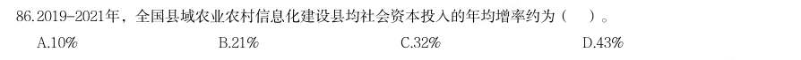

- **A.** 10%
- **B.** 21%
- **C.** 32%
- **D.** 43%

**答案：暂缺**

### 2024 广东·统一卷　第 89 题　（增长率比较）

2021年,关于县域农业农村信息化建设,下列数据同比增长率最大的是( )。

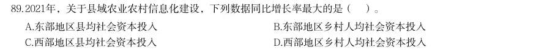

- **A.** 东部地区县均社会资本投入
- **B.** 东部地区乡村人均社会资本投入
- **C.** 西部地区县均社会资本投入
- **D.** 西部地区乡村人均社会资本投入

**答案：暂缺**

### 2024 国考·地市级　第 128 题　（增长率比较）

以下年份中,全国电信新兴业务收入同比增速最快的是:

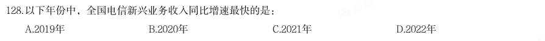

- **A.** 2019年
- **B.** 2020年
- **C.** 2021年
- **D.** 2022年

**答案：C**

### 2024 国考·行政执法　第 127 题　（增长率计算）

2023年一季度,我国机器人设备进出口贸易逆差比上年同期:

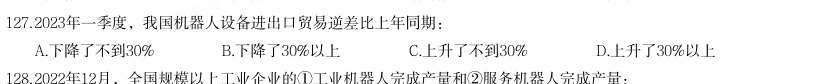

- **A.** 下降了不到30%
- **B.** 下降了30%以上
- **C.** 上升了不到30%
- **D.** 上升了30%以上

**答案：D**

### 2023 湖北·统一卷　第 116 题　（增长率计算）

2021 年,全国羊肉产量同比增长率约为:

- **A.** 2.4%
- **B.** 3.4%
- **C.** 4.4%
- **D.** 5.4%

**答案：D**

### 2023 湖北·统一卷　第 119 题　（增长率计算（综合））

假设羊肉每年以零售价格全部售罄,那么,2021 年羊肉销售收入同比增长约:

- **A.** 5.2%
- **B.** 10.4%
- **C.** 17.6%
- **D.** 22.7%

**答案：A**

### 2023 广东·乡镇　第 90 题　（增长率计算）

2021 年广东林业产值同比增长率( )。

- **A.** 小于5%
- **B.** 在5%-10%之间
- **C.** 在10%-15%之间
- **D.** 大于15%

**答案：D**

### 2023 广东·乡镇　第 92 题　（增长率计算）

2021 年,以下经济区域财政科学技术支出同比增长率最高的是( )。

- **A.** 珠江三角洲核心区
- **B.** 沿海经济带东翼地区
- **C.** 沿海经济带西翼地区
- **D.** 北部生态发展区

**答案：B**

### 2023 国考·行政执法　第 112 题　（增长率计算）

2017~2021年间,全国集成电路产量同比增速超过20%的年份有几个?

- **A.** 1
- **B.** 2
- **C.** 3
- **D.** 4

**答案：B**

### 2023 国考·行政执法　第 113 题　（增长率计算）

表中所列7个省市中,2019年集成电路产量同比增速超过2%的省市比上年:

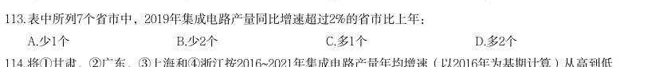

- **A.** 少1个
- **B.** 少2个
- **C.** 多1个
- **D.** 多2个

**答案：A**

### 2023 国考·行政执法　第 126 题　（降幅与增速）
> 材料：(四) 2021年,全国纺织品服装出口3155亿美元,同比增长8.4%。其中,纺织品出口1452.2亿美元,同比下降 5.6%,较2019年增长22.0%;服装出口1702.8亿美元,同比增长24.0%,较2019年增长16.0%。其中,针织服装 及衣着附件出口864.8亿美元,同比增长39.0%;梭织服装及衣着附件出口701.2亿美元,同比增长12.6%。 2021年,中国对美国、东盟、欧盟和日本的纺织品服装出口合计1724.9亿美元。其中,对美国出口额为 563.5亿美元…

2021年,中国向“一带一路”沿线国家出口纺织品服装1137.9亿美元,同比增长24.5%,较2019年增长 17.3%;同时,中国自“一带一路”沿线国家进口纺织品服装131.6亿美元,同比增长24.5%。 2020年,全国服装出口额比2019年:

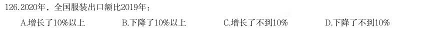

- **A.** 增长了10%以上
- **B.** 下降了10%以上
- **C.** 增长了不到10%
- **D.** 下降了不到10%

**答案：D**

### 2022 广东·乡镇　第 88 题　（增长率比较）

以下年份中,我国村(居)委会完成选举数同比增幅最大的是:

- **A.** 2017 年
- **B.** 2018 年
- **C.** 2019 年
- **D.** 2020 年

**答案：A**

### 2022 广东·乡镇　第 94 题　（增长率计算）

以下选项中,最准确地反映了2017-2020 年我国国际重要湿地面积、数量同步增速变化情况的是:

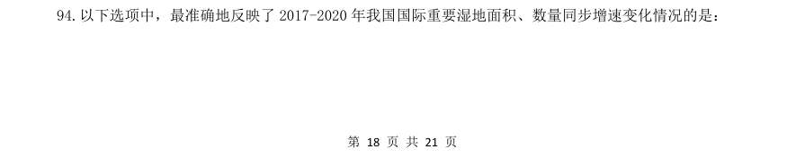

> （本题为图形题，选项为图片，见原卷）

**答案：D**

### 2022 广东·乡镇　第 96 题　（增长率计算（综合））

员数达148.1 万人,比上年增加3.6 万人,社区卫生人员数达52.1 万人,比上年增加3.3 万人。 2020 年,全国农村乡镇卫生院中,卫生人员数同比增长约:

- **A.** 1.4%
- **B.** 2.5%
- **C.** 3.6%
- **D.** 4.7%

**答案：暂缺**

### 2022 广东·县级　第 86 题　（降幅与增速）
> 材料：2020 年,全国职工基本医疗保险(以下简称职工医保)参保人数持续增加,基金收支规模基本稳定。参加职 工医保34455 万人,比上年同比增加1530 万人。其中在职职工25429 万人,比上年增长5.0%;退休职工9026 万 人,比上年增长3.7%。企业、机关事业、灵活就业等其他人员三类参保人员(包括在职职工和退休人员)分别为 23317 万人、6387 万人、4751 万人,分别比上年增加1050 万人、155 万人、325 万人。 受新冠肺炎疫情影响,2020 年2-7…

2020 年,职工医保个人账户收入6587 亿元,比上年增长12.8%;支出4936 亿元,比上年增长4.5%;当期结 存1650 亿元,累计结存10096 亿元。 2020 年就诊量同比有所减少。参加职工医保人员享受待遇17.9 亿人次,比上年减少15.6%。职工医保参保人 员住院率15.9%,比上年下降2.8 个百分点。其中:在职职工住院率为8.6%,比上年下降1.5 个百分点;退休职 工住院率为36.0%,比上年下降6.5 个百分点。 2020 年,全国参加职工医保人数同比增长约:

- **A.** 4.6%
- **B.** 5.4%
- **C.** 6.2%
- **D.** 7.1%

**答案：A**

### 2022 广东·县级　第 88 题　（增长率计算）

若2-7 月未实施阶段性减半征收职工医保单位缴费,则2020 年职工医保基金总收入(含生育保险)同比 增长:

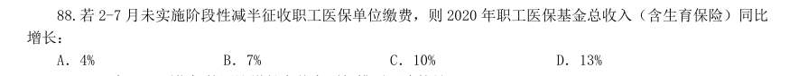

- **A.** 4%
- **B.** 7%
- **C.** 10%
- **D.** 13%

**答案：C**

### 2022 广东·县级　第 99 题　（增长率比较）

按不重复距离计算,以下年份中,国际航线里程同比增速最快的是:

- **A.** 2017 年
- **B.** 2018 年
- **C.** 2019 年
- **D.** 2020 年

**答案：暂缺**

### 2022 国考·副省级　第 122 题　（增长率计算（综合））

(单选题)2021 年第一季度市场监管部门食品安全监督抽检的总体不合格率在以下哪个范围内?

- **A.** 不到1%
- **B.** 1%—2%之间
- **C.** 2%—3%之间
- **D.** 3%以上

**答案：C**

### 2022 国考·地市级　第 122 题　（增长率计算（综合））

2021 年第一季度市场监管部门食品安全监督抽检的总体不合格率在以下哪个范围内?

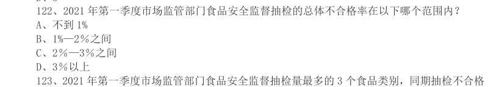

- **A.** 不到1%
- **B.** 1%—2%之间
- **C.** 2%—3%之间
- **D.** 3%以上

**答案：C**

### 2022 国考·行政执法　第 116 题　（降幅与增速）

下降10.3%。其中,受理量23792 件,较11 月减少6316 件;因举报线索不详或不属于生态环境部门职责范 围而未受理7364 件,较11 月减少3119 件。 (单选题)2020 年1 月,全国“12369 环保举报联网管理平台”接到环保举报件数比上个月:

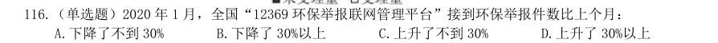

- **A.** 下降了不到30%
- **B.** 下降了30%以上
- **C.** 上升了不到30%
- **D.** 上升了30%以上

**答案：B**

### 2021 广东·乡镇　第 93 题　（增长率计算（综合））

2020 年前三季度,G 省智能机器人产业的总体利润率(利润率=利润总额/营业收入)约为( )。

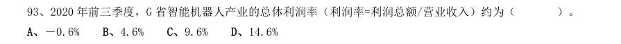

- **A.** -0.6%
- **B.** 4.6%
- **C.** 9.6%
- **D.** 14.6%

**答案：暂缺**

### 2021 广东·乡镇　第 94 题　（增长率计算（综合））

2020 年前三季度,G 省工业机器人制造业营业收入同比增长约( )亿元。

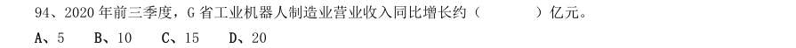

- **A.** 5
- **B.** 10
- **C.** 15
- **D.** 20

**答案：暂缺**

### 2021 广东·乡镇　第 97 题　（增长率计算（综合））

2020 年上半年,我国水、海产品出口额同比减少约( )亿美元。

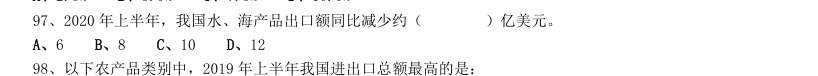

- **A.** 6
- **B.** 8
- **C.** 10
- **D.** 12

**答案：暂缺**

### 2021 国考·地市级　第 111 题　（增长率计算）

(材料1) “十三五”(2016—2020 年)最后一年我国LED 产业总产值要实现比“十二五”(2011—2015 年)最后一 年翻番的目标,总产值至少要同比增长:

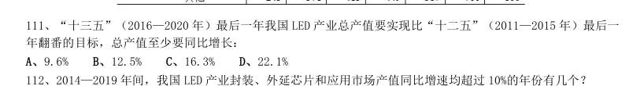

- **A.** 9.6%
- **B.** 12.5%
- **C.** 16.3%
- **D.** 22.1%

**答案：B**

### 2021 国考·地市级　第 112 题　（增长率计算）

2014—2019 年间,我国LED 产业封装、外延芯片和应用市场产值同比增速均超过10%的年份有几个?

- **A.** 1
- **B.** 2
- **C.** 3
- **D.** 4

**答案：C**

### 2021 国考·地市级　第 127 题　（增长率计算）

2019 年上半年,我国知识密集型服务进出口额环比约:

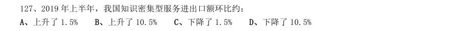

- **A.** 上升了1.5%
- **B.** 上升了10.5%
- **C.** 下降了1.5%
- **D.** 下降了10.5%

**答案：A**

### 2020 湖北·统一卷　第 107 题　（增长率计算）

2017 年中国人工智能市场规模同比增长率与2015 年相比约:

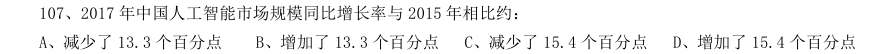

- **A.** 减少了13.3 个百分点
- **B.** 增加了13.3 个百分点
- **C.** 减少了15.4 个百分点
- **D.** 增加了15.4 个百分点

**答案：暂缺**

### 2020 湖北·统一卷　第 108 题　（增长率计算）

若按照2018 年同比增长率,到2019 年底中国人工智能市场规模约为:

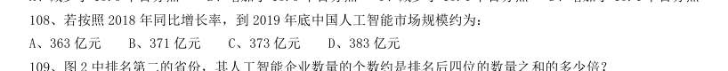

- **A.** 363 亿元
- **B.** 371 亿元
- **C.** 373 亿元
- **D.** 383 亿元

**答案：暂缺**

### 2020 湖北·统一卷　第 114 题　（增长率计算（综合））

2019 年5 月,邮政通信行业的受理量比房地产业约少:

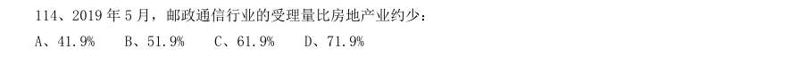

- **A.** 41.9%
- **B.** 51.9%
- **C.** 61.9%
- **D.** 71.9%

**答案：暂缺**

### 2020 广东·乡镇　第 93 题　（增长率计算（综合））

2019 年,下列行业中农民工月均收入同比增加最多的是:

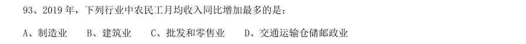

- **A.** 制造业
- **B.** 建筑业
- **C.** 批发和零售业
- **D.** 交通运输仓储邮政业

**答案：暂缺**

### 2020 广东·乡镇　第 98 题　（增长率计算）

2019 年,全国农产品网络零售额同比增长率较全国网络零售总额同比增长率高约( )个百分点。

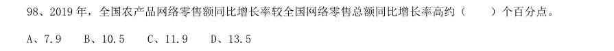

- **A.** 7.9
- **B.** 10.5
- **C.** 11.9
- **D.** 13.5

**答案：暂缺**

### 2020 广东·县级　第 98 题　（增长率计算（综合））

2018 年广东规模以上企业重复用水率约为:

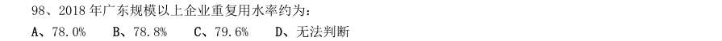

- **A.** 78.0%
- **B.** 78.8%
- **C.** 79.6%
- **D.** 无法判断

**答案：暂缺**

### 2020 广东·综合行政能力测验　第 89 题　（增长率计算）

下列选项中,能够正确反映四个细分市场同比增长率的是( )。

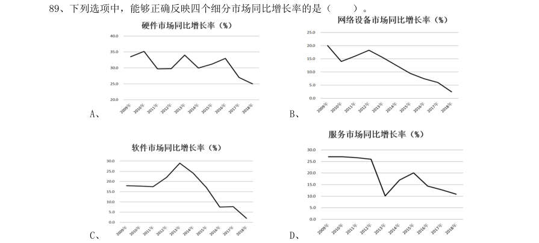

- **A.** 
- **B.** 
- **C.** 
- **D.** 

**答案：D**

### 2020 广东·综合行政能力测验　第 94 题　（增长率计算）

如果2019 年我国海洋新兴产业保持2018 年的增速,则2019 年我国海洋新兴产业产值将比2017 年 多约( )。

- **A.** 
- **B.** 
- **C.** 
- **D.** 

**答案：暂缺**

### 2020 国考·地市级　第 113 题　（增长率计算）

2011~2018 年间,我国海洋主题公园非门票收入同比增速超过10%的年份有几个?

- **A.** 5
- **B.** 6
- **C.** 3
- **D.** 4

**答案：A**

### 2020 国考·地市级　第 118 题　（增长率比较）

2013~2018 年间中国集成电路产业销售额增速最高的年份,当年集成电路进口金额同比约增加:

- **A.** 5%
- **B.** 10%
- **C.** 15%
- **D.** 20%

**答案：C**

### 2020 国考·地市级　第 122 题　（增长率计算（综合））

2017 年中国在线旅游收入同比约增长多少万亿元?

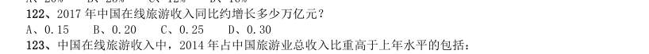

- **A.** 0.15
- **B.** 0.20
- **C.** 0.25
- **D.** 0.30

**答案：A**

### 2020 国考·省级　第 117 题　（增长率计算（综合））

2017 年中国在线旅游收入同比约增长多少万亿元?

- **A.** 0.15
- **B.** 0.20
- **C.** 0.25
- **D.** 0.30

**答案：A**
