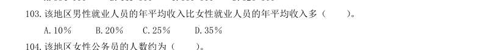

# 资料分析 · 年均增长率 · 2000 年代真题

> 所属考点：[ZL-YEAR](../ZL-YEAR-年均增长率.md)　｜　本片 5 题

### 2009 广东·统一卷　第 94 题　（年均增长率计算）

2001-2008 年,社会投资用于地质勘查投资的资金平均每年约增加多少亿美元:

- **A.** 52.1
- **B.** 59.5
- **C.** 72.9
- **D.** 416.8

**答案：暂缺**

### 2009 国考·统一卷　第 134 题　（年均增长率比较）

2007 年,港口货物吞吐量和集装箱吞吐量均低于全年平均水平的月份有几个:

- **A.** 2
- **B.** 3
- **C.** 4
- **D.** 5

**答案：A**

### 2009 国考·统一卷　第 136 题　（年均增长率计算）
> 材料：全国2007 年认定登记的技术合同共计220868 项,同比增长7%,总成交金额2226 亿元,同比增长22.44%; 平均每项技术合同成交金额突破百万元大关,达到100.78 万元。 2007 年全国共签订技术开发合同73320 项,成交金额876 亿元,分别比上年增长了13.5% 和22.2%;共签订 技术转让合同11474 项,成交金额420 亿元,成交金额同比增长30.8%;技术服务和技术咨询合同成交金额分 别为840 亿元和90 亿元,分别比上年增长了20.9% 和…

2007 年,在全国认定登记的技术合同中,涉及技术秘密、计算机软件、专利、集成电路、生物医药、动植物新 品种等各类知识产权的技术合同共计109740 项,成交金额1477 亿元,较上年增长23.5%,其中,技术秘密和 计算机软件著作权的技术交易成交额居第一,第二,技术秘密合同成交76261 项,成交金额1008 亿元,较上 年增长29.2%;计算机软件著作权合同成交27617 项,成交金额255 亿元,较上年增长了15.4%。 2007 年平均每项技术合同成交金额同比增长率为多少:

- **A.** 8.15%
- **B.** 14.43%
- **C.** 25.05%
- **D.** 35.25%

**答案：B**

### 2003 国考·B卷　第 119 题　（年均增长率比较）

117.90 年代中期,人口年平均自然增长数最大的地区为(

- **A.** 亚洲人大部分都移民欧洲
- **B.** 非洲的移民数量仅次于亚洲
- **C.** 欧洲人口的增长率最低
- **D.** 大洋洲移民数和人口总增长量最少

**答案：C**

### 2001 国考·统一卷　第 103 题　（年均增长率计算）

该地区男性就业人员的年平均收入比女性就业人员的年平均收入多( )。

- **A.** 10%
- **B.** 20%
- **C.** 25%
- **D.** 35%

**答案：D**
