# 资料分析 · 年均增长率 · 2010 年代真题

> 所属考点：[ZL-YEAR](../ZL-YEAR-年均增长率.md)　｜　本片 21 题

### 2019 湖北·统一卷　第 107 题　（年均增长率计算）

2013 年至2017 年我国成年国民人均期刊阅读量超过这五年平均水平的年份有:

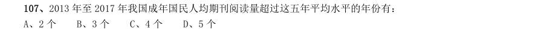

- **A.** 2 个
- **B.** 3 个
- **C.** 4 个
- **D.** 5 个

**答案：B**

### 2019 湖北·统一卷　第 111 题　（年均增长率计算）
> 材料：2014 年我国实施“单独两孩”生育政策,出生人口1687 万人,比上年增加47 万人。2016 年实施“全面 两孩”生育政策,出生人口1786 万人,比上年增加131 万人;出生率与“十二五”时期年平均出生率相比,提 高了0.84 个千分点。2017 年我国出生人口1723 万人,虽然比上年减少63 万人,但比“十二五”时期年平均 出生人口多出79 万人;出生率为 ,比上一年降低0.52 个千分点。2017 年二孩数量进一步上升至883 万 人,二孩占全部出生人口的比重达到…

2013 年我国出生人口比“十二五”时期年平均出生人口:

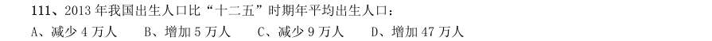

- **A.** 减少4 万人
- **B.** 增加5 万人
- **C.** 减少9 万人
- **D.** 增加47 万人

**答案：A**

### 2019 湖北·统一卷　第 112 题　（年均增长率计算）

“十二五”时期我国年平均出生率为:

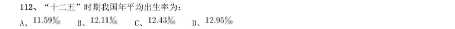

- **A.** 
- **B.** 
- **C.** 
- **D.** 

**答案：B**

### 2019 广东·乡镇　第 99 题　（年均增长率计算）

2014-2017 年,A 省平均每年新增申报无公害农产品产地认定( )个。

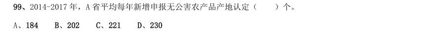

- **A.** 184
- **B.** 202
- **C.** 221
- **D.** 230

**答案：暂缺**

### 2019 广东·思维能力测验　第 10 题　（年均增长率计算）

据统计,某企业生产的所有型号空调的销量比往年均有大幅度提升。该企业由此认为,今年他们生产 的空调的市场占有率也会大幅提高。 以下最能说明上述推理存在漏洞的是()。

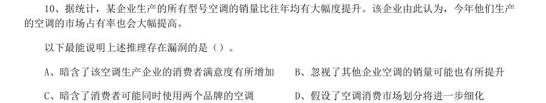

- **A.** 暗含了该空调生产企业的消费者满意度有所增加
- **B.** 忽视了其他企业空调的销量可能也有所提升
- **C.** 暗含了消费者可能同时使用两个品牌的空调
- **D.** 假设了空调消费市场划分将进一步细化

**答案：B**

### 2018 广东·统一卷　第 97 题　（年均增长率计算）

2013—2016 年,全省医疗卫生机构平均每年较上一年增加执业(助理)医师约( )万人。

- **A.** 0.9
- **B.** 1.1
- **C.** 1.7
- **D.** 2.1

**答案：暂缺**

### 2016 广东·乡镇　第 96 题　（年均增长率计算）

2006 年至2011 年期间,平均每年增加的人数为( )万人。

- **A.** 531.3
- **B.** 657.4
- **C.** 752.4
- **D.** 839.2

**答案：暂缺**

### 2016 广东·县级　第 86 题　（年均增长率计算）

计算和判断处理。 (一) 2006 年至2011 年期间,平均每年增加的人数为( )万人。

- **A.** 531.3
- **B.** 657.4
- **C.** 752.4
- **D.** 839.2

**答案：暂缺**

### 2015 广东·县级　第 89 题　（年均增长率计算）

2014 年 月,最接近我国手机出货量全年平均数的月份是:

- **A.** 5 月
- **B.** 8 月
- **C.** 9 月
- **D.** 10 月

**答案：暂缺**

### 2014 广东·乡镇　第 96 题　（年均增长率计算）

据统计,2013 年广东省城镇化私营单位就业人员年平均工资为37020 元,比上年增长16.0%,增幅回落3.9 个百分点。 2013 年广东省城镇私营单位分区域就业人员年平均工资图(单位:元) 2013 年,我省城镇化私营单位就业人员年平均工资比2012 年增加了( )元。

- **A.** 5100
- **B.** 5200
- **C.** 5300
- **D.** 5400

**答案：暂缺**

### 2014 广东·乡镇　第 97 题　（年均增长率比较）

2013 年,城镇私营单位就业人员年平均工资与2012 年相比,增长最慢的区域是:

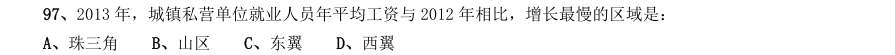

- **A.** 珠三角
- **B.** 山区
- **C.** 东翼
- **D.** 西翼

**答案：暂缺**

### 2014 广东·乡镇　第 98 题　（年均增长率计算）

2012 年,我省城镇私营单位就业人员年平均工资最高的区域约为最低区域的( )倍。

- **A.** 1.2
- **B.** 1.8
- **C.** 1.5
- **D.** 2.0

**答案：暂缺**

### 2014 广东·乡镇　第 99 题　（年均增长率计算）

2011 年,我省城镇私营单位就业人员年平均工资约为( )元。

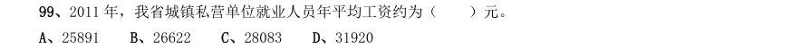

- **A.** 25891
- **B.** 26622
- **C.** 28083
- **D.** 31920

**答案：暂缺**

### 2014 广东·乡镇　第 100 题　（年均增长率比较）

如果2014 年我省各区域城镇私营单位就业人员年平均工资保持2013 年的增长速度,则2014 年各区域年 平均工资从高到底的正确排序是:

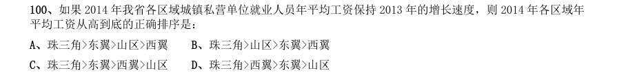

- **A.** 珠三角>东翼>山区>西翼
- **B.** 珠三角>山区>东翼>西翼
- **C.** 珠三角>东翼>西翼>山区
- **D.** 珠三角>西翼>东翼>山区

**答案：暂缺**

### 2014 国考·统一卷　第 116 题　（年均增长率比较）
> 材料：根据资料所提供的信息进行分析、比较、计算和判断处理。 一、 根据以下资料,回答116—120 题。 2012 年全国国道网车流量较大的地区主要集中在北京、天津、上海、江苏、浙江、广东和山东,上述省市 国道网的日平均交通量均超过2 万辆。全国国道网日平均行驶量为244883 万车公里,北京、天津、河北、山西、 上海、浙江、湖北、广东的国道年平均拥挤度均超过0.6。其中,国家高速公路日平均交通量为22181 辆,日平 均行驶量为148742 万车公里;普通国道日平均交通量为108…

) 2008—2012 年全国国道与高速公路日平均交通量及年平均交通拥挤度 2009—2012 年全国国道日平均交通量同比增速最快的一年是:

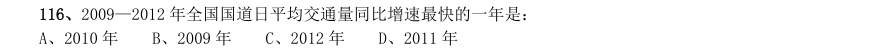

- **A.** 2010 年
- **B.** 2009 年
- **C.** 2012 年
- **D.** 2011 年

**答案：C**

### 2014 国考·统一卷　第 117 题　（年均增长率比较）

2008—2012 年全国国道与高速公路年平均拥挤度数值相差最小的年份,高速公路全年日平均交通量为:

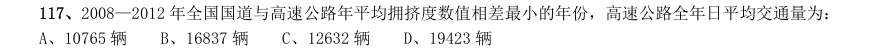

- **A.** 10765 辆
- **B.** 16837 辆
- **C.** 12632 辆
- **D.** 19423 辆

**答案：B**

### 2011 湖北·统一卷　第 101 题　（年均增长率计算）

请你根据资料所提供的信息进行分析、比较、计算和判断处理。 (一)根据以下资料,完成各题。 A0 级型车比A00 级型车在过去的五年中每年平均销售份额约高出:

- **A.** 15 个百分点
- **B.** 14 个百分点
- **C.** 16 个百分点
- **D.** 17 个百分点

**答案：B**

### 2010 湖北·统一卷　第 106 题　（年均增长率计算）

根据以下资料,完成各题。 2000-2009 年,农村居民家庭人均纯收入平均每年增长:

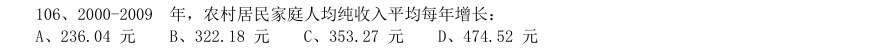

- **A.** 236.04 元
- **B.** 322.18 元
- **C.** 353.27 元
- **D.** 474.52 元

**答案：B**

### 2010 国考·统一卷　第 111 题　（年均增长率计算）

1949-2008 年,我国卫生机构平均每年约增加:

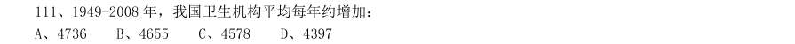

- **A.** 4736
- **B.** 4655
- **C.** 4578
- **D.** 4397

**答案：B**

### 2010 国考·统一卷　第 112 题　（年均增长率比较）

建国以来,我国医院和卫生院床位数年平均增长率最高的时期为:

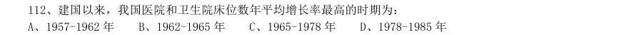

- **A.** 1957-1962 年
- **B.** 1962-1965 年
- **C.** 1965-1978 年
- **D.** 1978-1985 年

**答案：A**

### 2010 国考·统一卷　第 113 题　（年均增长率计算）

与1978 年相比,2008 年平均每个卫生机构的卫生技术人员数约增加了:

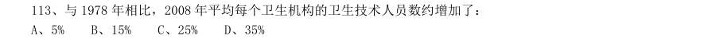

- **A.** 5%
- **B.** 15%
- **C.** 25%
- **D.** 35%

**答案：C**
