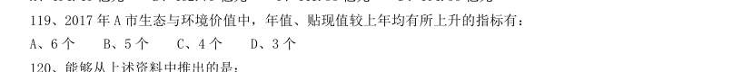

# 资料分析 · 年均增长率 · 2020 年代真题

> 所属考点：[ZL-YEAR](../ZL-YEAR-年均增长率.md)　｜　本片 1 题

> 本片子考点：年均增长率计算 1

### 2020 湖北·统一卷　第 119 题　（年均增长率计算）

2017 年A 市生态与环境价值中,年值、贴现值较上年均有所上升的指标有:

- **A.** 6 个
- **B.** 5 个
- **C.** 4 个
- **D.** 3 个

**答案：暂缺**
